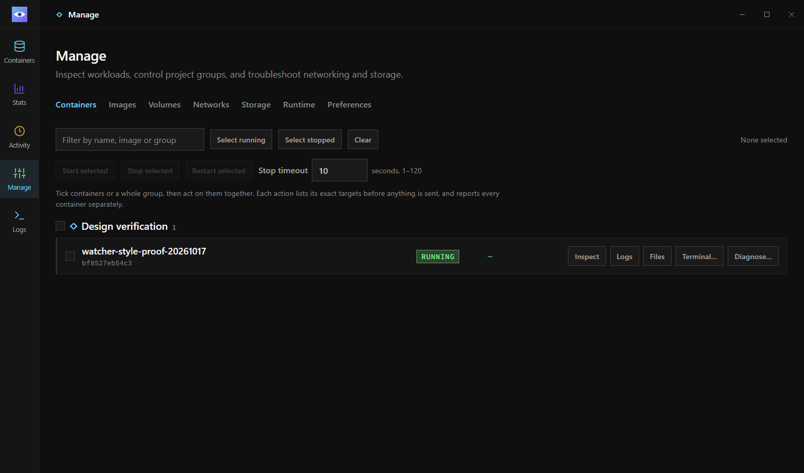

# Watcher

Watcher is a small Windows app that watches the WSL containers on your machine (`wslc`) live and keeps a local history of their CPU, memory and lifecycle.



## Features

- **Containers.** Every container with live CPU and memory sparklines, port, uptime and state. Start, stop, restart, remove, follow logs and open the container's folder. Every column sorts, newest first by default, and labels decide the sections (see [Labels](#labels)). A collapsed list at the bottom keeps every removed container, ten per page, marked as reaped, removed in Watcher or removed outside Watcher, with its lifetime, peak memory and average CPU.
- **Stats.** CPU and memory history over the last hour, 24 hours, 7 days or 30 days, with peaks and a per-container table: averages, p95, max, network and disk totals, uptime and restarts.
- **Activity.** A log of everything Watcher observed: containers appearing and disappearing, state and port changes, CPU and memory alerts, the actions you took, and the changes that happened while Watcher was closed.
- **Copy for AI.** Copies a Markdown report of a range to the clipboard and saves it to disk. The report holds the totals, the per-container table and the full event log, ready to paste into a chat and ask what changed since yesterday.

The management expansion adds controls for existing workloads. Container creation, builds, cloning/recreation and stack launching are deliberately excluded. Creating new networks, volumes or images is excluded too.

- **Inspect and troubleshoot.** Open a container's full configuration, masked environment, health, exit code, resource budgets, mounts, networks and port mappings. Open Windows Terminal with a chosen shell, user and working directory. Browse files and explicitly copy them between Windows and the container.
- **Manage.** Select containers or a project group for lifecycle actions with individual results and a stop timeout. Browse existing images, networks and volumes; inspect or remove selected unused resources; change network membership; and export an image or back up a volume through an existing stopped container.
- **Logs.** Read timestamped logs from several containers together, search and filter by time, follow or pause, and export a range. Activity entries link to nearby logs.
- **Runtime.** Inspect runtime version, active sessions and supported capabilities, read native container events, open WSLc's own settings and explicitly terminate Watcher's active session. Windows TCP/HTTP checks help distinguish a running process from a reachable service. Storage information distinguishes space inside session disks from their Windows file sizes.
- **Preferences.** Configure alert thresholds, recovery levels, sustained sample counts and container overrides. Tray monitoring, Windows tray notifications and launch at sign-in are opt-in. Selecting another session takes effect after restarting Watcher; the current window keeps its original target.

Changing an existing container's CPU or memory limit requires recreation in the current WSLc CLI, so Watcher displays those limits without offering an edit action. Native Compose launch is outside this scope. Opening WSLc settings delegates editing and validation to WSLc; it does not migrate an existing session disk.

File uploads target the folder being browsed and keep their Windows filename. This matches WSLc's requirement for an existing upload destination. Folder exports and volume backups preserve directory targets explicitly.

Failed or cancelled transfers can leave partial output; Watcher reports its exact destination in the error and action history. Check that output before using it as a backup or retrying an overwrite. Session termination pauses monitoring until you explicitly resume, so polling cannot immediately start the session again.

Percentages are relative to WSL: the virtual machine the containers run in, which can be smaller than the PC. CPU is a share of WSL's processors, so 100 % means every processor WSL has is busy, and memory totals are a share of WSL's memory. Watcher measures WSL's size by running `grep` in a running container at startup and every 10 minutes; until that works, it uses Windows' size and says WSL's size is not measured yet. A row of smaller Windows cards under the tiles shows the same totals against the whole PC, and the Copy for AI report gives both. (`wslc stats` itself reports CPU per core, where 400 % means four cores; Watcher stores cores busy and divides when it shows them.)

## Requirements

- Windows 11.
- WSL with container support (`wslc`). Run `wsl --update` if `wslc` is missing.
- [.NET 10 Desktop Runtime](https://dotnet.microsoft.com/download/dotnet/10.0) (the SDK to build).
- [WebView2 Runtime](https://developer.microsoft.com/microsoft-edge/webview2/), which Windows 11 already includes.

## Build and run

```powershell
dotnet run -c Release
dotnet test tests/Watcher.Tests -c Release
dotnet publish -c Release
```

`dotnet publish` puts `Watcher.exe` and the `web` folder it serves in `bin/Release/net10.0-windows/publish/`.

## Labels

Watcher reads two container labels.

| Label | What it does |
| --- | --- |
| `watcher.path` | The folder the container belongs to. Watcher shows the folder's name, its git branch and an Open folder button. When the folder is deleted while its parent still exists, the container shows as "folder deleted", and Reap removes every such container. |
| `watcher.group` | The section the container is listed under. Docker Compose's `com.docker.compose.project` label works too. |

Without a group label, containers whose folders share a parent folder are listed together under that parent's name. Everything else goes under Other. When there is only one section, it has no header.

```powershell
wslc run --detach --name web-app --label watcher.path=C:/src/shop/main --label watcher.group=shop nginx
```

## Settings

An optional `settings.json` in the data folder picks other labels. These are the defaults:

```json
{ "pathLabels": ["watcher.path"], "groupLabels": ["watcher.group", "com.docker.compose.project"] }
```

On each container, the first label in a list that is present wins. A missing key, or a file that is not valid JSON, falls back to the defaults. Restart Watcher after editing the file.

## Where data lives

Everything is in `%LOCALAPPDATA%\Watcher`:

- `watcher.db` is a SQLite database. Raw samples are kept for 72 hours; per-minute rollups and the activity log are kept forever.
- `exports\` holds the Copy for AI reports.
- `settings.json` holds the optional settings above.
- `preferences.json` holds runtime targeting, background behavior and alert rules. Explicit non-default sessions keep separate databases and WebView profiles under `sessions\`.
- `window.json` remembers the window position, and `WebView2\` is the page's browser profile.

The Stats page shows the database's size, row counts and write times, and opens the folder.

History and preferences stay on your machine. Watcher has no telemetry and serves its page from local files. Diagnostic HTTP/TCP/DNS requests run only when you request them. Export and file-copy actions write to the location you choose.

If an existing `preferences.json` cannot be read or is invalid, startup stops with its path and error. Watcher never substitutes the default session for an unreadable saved target. Restore or fix that file before restarting.

## Verify management changes

```powershell
dotnet test tests/Watcher.Tests -c Release --no-restore
pwsh -NoProfile -File tools/verify-management.ps1
```

The native verification requires an already-cached `alpine:3.20` image. It creates a uniquely labeled disposable container and volume, launches Watcher with temporary data on a separate Windows desktop, drives its real WebView bridge and captures the pages. It never changes the input desktop. Cleanup checks the fixture's identity and label before removing it. Artifact paths are printed by the script. It does not exercise user resources or pull an image.

The proof covers page routes and Manage tabs, rendered logs, inspection, file browsing, copy in/out, stopped-volume backup integrity, bulk start/stop/restart, finite runtime events and HTTP readiness. Interactive Terminal, the Explorer tray, sign-in registration, and terminating a user's active session require manual checks; the script does not invoke them.

## Credits

Numbers are set in [Source Code Pro](https://github.com/adobe-fonts/source-code-pro) by Adobe, under the SIL Open Font License 1.1 (`web/fonts/OFL.txt`).

## License

MIT. See [LICENSE](LICENSE).
