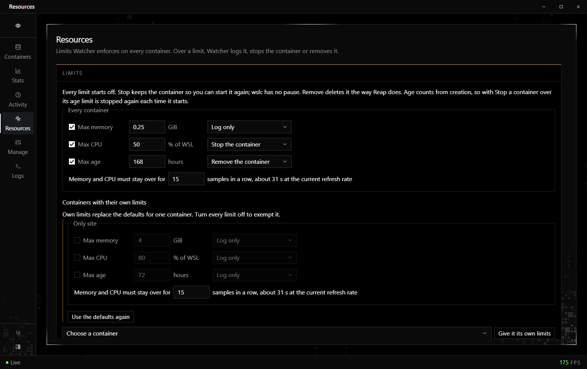
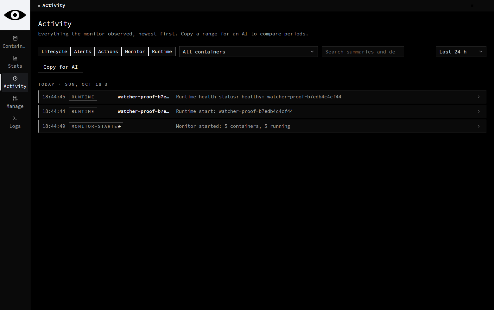

# Watcher: a desktop GUI for WSL containers (wslc) on Windows 11

[](LICENSE)


[](CONTRIBUTING.md)

Watcher is a free, open-source dashboard for **WSLC**, the container runtime built into the Windows Subsystem for Linux. It shows every WSL container live with CPU and memory sparklines, keeps a local history, and enforces memory, CPU and age limits. From the same window you can inspect, start, stop, restart and remove containers, read their logs, and manage images, volumes and networks. Think of it as a lightweight, Docker Desktop-style window for `wslc`, with no account, no telemetry and no background service.


## Why Watcher

- **See what WSL is running.** `wslc list` and `wslc stats` are one-off snapshots. Watcher refreshes every couple of seconds and groups containers by project.
- **Know what happened.** Every start, stop, crash, port change and CPU or memory spike is recorded, including what changed while Watcher was closed.
- **Keep WSL under control.** Set a maximum memory, CPU or age, and have Watcher log, stop or remove the containers that go over it.
- **Stay local.** History lives in a SQLite file on your machine. Watcher makes no network calls of its own.

## Features

- **Containers.** Live CPU and memory sparklines, port, uptime and state for every container, grouped by project label or folder. Start, stop, restart, remove, follow logs and open the project folder. Removed containers stay listed with their lifetime, peak memory and average CPU.
- **Stats.** CPU and memory history for the last hour, 24 hours, 7 days or 30 days, with peaks and a per-container table of averages, p95, max, network and disk totals, uptime and restarts.
- **Activity.** A searchable log of containers appearing and disappearing, state and port changes, CPU and memory alerts, limit breaches, and every action you took.
- **Resources.** Limits on memory (GiB), CPU (% of WSL) and age (hours). Each limit can log, stop or remove. A container can have its own limits or be exempt. See [Resource limits](#resource-limits).
- **Manage.** Act on many containers or a whole project at once, with a result for each container. Browse images, networks and volumes, remove unused ones, export an image and back up a volume.
- **Logs.** Timestamped logs from several containers in one view. Search, filter by time, follow, pause and export.
- **Inspect and troubleshoot.** Full configuration, masked environment variables, health, exit code, resource budgets, mounts, networks and port mappings. Open Windows Terminal inside a container, browse its files and copy files in and out. TCP and HTTP checks tell a running process apart from a reachable service.
- **Runtime.** WSLC version, sessions, capabilities and native container events. Opens WSLC's own settings file.
- **Alerts and tray.** CPU and memory alert thresholds with recovery levels, per-container overrides, optional Windows notifications and an optional tray mode.
- **Copy for AI.** Copies a Markdown report of a time range, with the totals, the per-container table and the event log, ready to paste into a chat and ask what changed.

| Resource limits | Activity |
| --- | --- |
|  |  |

## Requirements

- Windows 11.
- WSL with container support (`wslc`). Run `wsl --update` if `wslc` is missing.
- The [.NET 10 SDK](https://dotnet.microsoft.com/download/dotnet/10.0), only if you build from source. The release download includes .NET.
- [WebView2 Runtime](https://developer.microsoft.com/microsoft-edge/webview2/), which Windows 11 already includes.

## Install

Download `Watcher-<version>-win-x64.zip` from the [latest release](https://github.com/Medalink/watcher/releases/latest), unzip it anywhere (for example `%LOCALAPPDATA%\Programs\Watcher`), and run `Watcher.exe`. The build is self-contained, so you don't need to install .NET. The exe isn't code-signed yet, so the first time you run it Windows SmartScreen may show "Windows protected your PC". Choose **More info**, then **Run anyway**.

To build from source instead, install the .NET 10 SDK and run:

```powershell
git clone https://github.com/Medalink/watcher.git
cd watcher
dotnet publish -c Release
```

Then run `bin\Release\net10.0-windows\publish\Watcher.exe`. Pin it to Start or the taskbar, or turn on **Start Watcher when I sign in** in Manage → Preferences. Only one Watcher runs per device, even across Windows users, because it watches every container on the machine. Launching it again brings the open window to the front.

## Quick start

Start any container with `wslc` and it appears in Watcher within a few seconds. Two optional labels make the list more useful:

```powershell
wslc run --detach --name web-app --label watcher.path=C:/src/shop/main --label watcher.group=shop nginx
```

`watcher.path` links the container to a project folder, so Watcher shows its git branch and an Open folder button. `watcher.group` puts it under a section heading. See [Labels](#labels).

## Resource limits

The Resources page sets limits that Watcher enforces on every container.

| Limit | Measured as | Acts after |
| --- | --- | --- |
| Max memory | GiB in use | 15 samples in a row over the limit (about 30 seconds; configurable) |
| Max CPU | % of WSL's processors | the same number of samples |
| Max age | hours since the container was created | the next refresh |

Each limit has its own action:

- **Log only** records the breach in Activity and shows a Windows notification if notifications are on.
- **Stop** stops the container, and you can start it again. `wslc` has no pause command, so Stop is the reversible option.
- **Remove** deletes the container and everything in it that is not on a volume.

Every limit starts off. A container can have its own limits, and turning all of them off exempts it. Before you save, the page shows which containers are over each limit right now, and asks for confirmation when saving would stop or remove one. A breach fires once, then re-arms when the value drops back under the limit. With Stop, an over-age container is therefore stopped again each time it starts.

## How Watcher measures

Percentages are relative to WSL: the virtual machine the containers run in, which can be smaller than the PC. CPU is a share of WSL's processors, so 100 % means every processor WSL has is busy, and memory totals are a share of WSL's memory. Watcher measures WSL's size by running `grep` in a running container at startup and every 10 minutes. Until that works, it uses Windows' size and says WSL's size is not measured yet. A row of smaller Windows cards under the tiles shows the same totals against the whole PC, and the Copy for AI report gives both. (`wslc stats` itself reports CPU per core, where 400 % means four cores; Watcher stores cores busy and divides when it shows them.)

## What Watcher does not do

Watcher manages containers that already exist. It does not create containers, build images, clone or recreate containers, launch Compose stacks, or create networks, volumes or images.

Changing an existing container's CPU or memory limit requires recreation in the current WSLc CLI, so Watcher displays those limits without offering an edit action. Native Compose launch is outside this scope. Opening WSLc settings delegates editing and validation to WSLc; it does not migrate an existing session disk.

File uploads target the folder being browsed and keep their Windows filename. This matches WSLc's requirement for an existing upload destination. Folder exports and volume backups preserve directory targets explicitly.

Failed or cancelled transfers can leave partial output; Watcher reports its exact destination in the error and action history. Check that output before using it as a backup or retrying an overwrite. Session termination pauses monitoring until you explicitly resume, so polling cannot immediately start the session again.

## Labels

Watcher reads two container labels.

| Label | What it does |
| --- | --- |
| `watcher.path` | The folder the container belongs to. Watcher shows the folder's name, its git branch and an Open folder button. When the folder is deleted while its parent still exists, the container shows as "folder deleted", and Reap removes every such container. |
| `watcher.group` | The section the container is listed under. Docker Compose's `com.docker.compose.project` label works too. |

Without a group label, containers whose folders share a parent folder are listed together under that parent's name. Everything else goes under Other. When there is only one section, it has no header.

```powershell
wslc run --detach --name web-app --label watcher.path=C:/src/shop/main --label watcher.group=shop nginx
```

## Settings

An optional `settings.json` in the data folder picks other labels. These are the defaults:

```json
{ "pathLabels": ["watcher.path"], "groupLabels": ["watcher.group", "com.docker.compose.project"] }
```

On each container, the first label in a list that is present wins. A missing key, or a file that is not valid JSON, falls back to the defaults. Restart Watcher after editing the file.

## Where data lives

Everything is in `%LOCALAPPDATA%\Watcher`:

- `watcher.db` is a SQLite database. Raw samples are kept for 72 hours; per-minute rollups and the activity log are kept forever.
- `exports\` holds the Copy for AI reports.
- `settings.json` holds the optional settings above.
- `preferences.json` holds runtime targeting, background behavior and alert rules. Explicit non-default sessions keep separate databases and WebView profiles under `sessions\`.
- `window.json` remembers the window position, and `WebView2\` is the page's browser profile.

The Stats page shows the database's size, row counts and write times, and opens the folder.

History and preferences stay on your machine. Watcher has no telemetry and serves its page from local files. Diagnostic HTTP/TCP/DNS requests run only when you request them. Export and file-copy actions write to the location you choose.

If an existing `preferences.json` cannot be read or is invalid, startup stops with its path and error. Watcher never substitutes the default session for an unreadable saved target. Restore or fix that file before restarting.

## FAQ

**Is there a GUI for WSL containers?**
Yes. Watcher is a desktop app for `wslc`, the WSL container CLI. It shows live CPU and memory, history, logs and limits, and runs container actions for you.

**Does Watcher replace Docker Desktop?**
Not entirely. It monitors and manages the containers you run with `wslc`, but it does not build images or create containers. Use `wslc run` and `wslc build` for those.

**Can Watcher stop or remove containers that use too much memory or run too long?**
Yes. Set a limit on the Resources page and choose Stop or Remove. See [Resource limits](#resource-limits).

**Does it work with Docker or Podman containers?**
No. Watcher reads WSLC through `wslc.exe`. It does honor Docker Compose's project label for grouping when a container carries it.

**Does Watcher send data anywhere?**
No. There is no telemetry. History and preferences stay in `%LOCALAPPDATA%\Watcher`.

**Why is memory a percentage of WSL rather than of my PC?**
Containers run inside the WSL virtual machine, which usually has less memory than Windows. See [How Watcher measures](#how-watcher-measures).

## Contributing

Pull requests are welcome, from a typo fix to a new feature. [CONTRIBUTING.md](CONTRIBUTING.md) covers setup, tests and what makes a pull request quick to merge. Report bugs and suggest ideas in [issues](https://github.com/Medalink/watcher/issues).

## Verify management changes

```powershell
dotnet test tests/Watcher.Tests -c Release --no-restore
pwsh -NoProfile -File tools/verify-management.ps1
```

The native verification requires an already-cached `alpine:3.20` image. It creates a uniquely labeled disposable container and volume, launches Watcher with temporary data on a separate Windows desktop, drives its real WebView bridge and captures the pages. It never changes the input desktop. Cleanup checks the fixture's identity and label before removing it. Artifact paths are printed by the script. It does not exercise user resources or pull an image.

The proof covers page routes and Manage tabs, rendered logs, inspection, file browsing, copy in/out, stopped-volume backup integrity, bulk start/stop/restart, finite runtime events and HTTP readiness. Interactive Terminal, the Explorer tray, sign-in registration, and terminating a user's active session require manual checks; the script does not invoke them.

## Credits

Numbers are set in [Source Code Pro](https://github.com/adobe-fonts/source-code-pro) by Adobe, under the SIL Open Font License 1.1 (`web/vendor/signal/fonts/OFL.txt`). The interface is built on the Signal design kit (MIT). [THIRD-PARTY-NOTICES.md](THIRD-PARTY-NOTICES.md) lists every bundled component and its license.

## License

MIT, © 2026 [MedaNet LLC](https://medanet.co). See [LICENSE](LICENSE).
